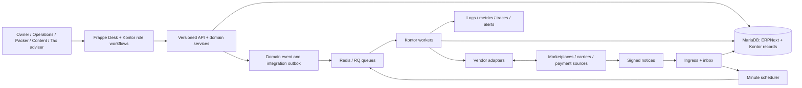

# Kontor — architecture and engineering notes

Kontor is a commerce operations system built on ERPNext and Frappe. I designed and built it for a seller working across several marketplace stores and shipping integrations. The product connects order intake, stock, catalog, packing, parcels, returns, and accounting handoffs in role-specific workflows.

**[See the product and use the sandbox](https://hammadbhutta.dev/kontor/)** · **[See selected work](https://hammadbhutta.dev/portfolio/)** · **[CV](https://hammadbhutta.dev/cv/)**

This repository is a public technical case study. The application source and merchant deployment remain private while a distribution and license review is pending. The public demo uses fictional records and Shopify and DHL test environments. Nothing here is a production credential, customer export, or runnable copy of the application.

## The engineering problem

An order is more than a row imported from a marketplace. Its items must map to a catalog, stock and delivery rules must be checked, a person may need to resolve a hold, the packer must know what to put in a parcel, a carrier may create a label, and returns or financial documents may follow. Each step can fail independently, and external systems may be slow, rate limited, or temporarily unavailable.

Kontor's central design choice is to keep those handoffs **durable and explainable**. A request records intent in the database; workers perform external effects; the order and operations screens show the state and the next decision.

## System at a glance

ERPNext supplies accounting and stock foundations; Kontor adds modules for channel orders, catalog, shipping, returns, finance, operations, and integrations. A vendor adapter translates its API to typed internal data. It does not own persistence or retry behavior.

## Read the architecture

| Document | What it explains |
| --- | --- |
| [System boundaries](docs/system-boundaries.md) | Modules, ownership, deployment, and why adapters stay separate from domain services. |
| [Event processing](docs/event-processing.md) | Inbox, outbox, idempotency keys, worker claims, retries, concurrency, and uncertain external effects. |
| [Order to parcel](docs/order-to-parcel.md) | A concrete order path from marketplace intake through human decisions, packing, carrier work, and later returns. |
| [Security and operations](docs/security-and-operations.md) | Roles, company and data boundaries, credentials, observability, recovery, and verification strategy. |
| [Engineering decisions](docs/engineering-decisions.md) | Tradeoffs and limits, including where this design deliberately favors reliability over immediacy. |

## What to inspect in the live sandbox

1. Open the [Kontor product page](https://hammadbhutta.dev/kontor/) and choose the **Owner** account. Inspect Channel Orders and an order on hold; the reason and next action are placed with the order.
2. Switch to **Packer**. The pack station presents the parcel's items and actions without exposing owner-level settings.
3. Return to **Owner** and inspect the Shipping Work Queue and parcel state.
4. Use the other role accounts to see how catalog and finance work are separated.

The public environment is a demonstration, not evidence that every vendor adapter is connected to a live merchant. Its Shopify and DHL connections use test environments; its buyer and company records are fictional.

## Implementation map

These paths identify where the mechanisms live in the private application source. They are here to make this case study reviewable in an interview, not to imply that the source is public.

| Mechanism | Private source location |
| --- | --- |
| Adapter contract and typed DTOs | `kontor/connectors/base/` |
| Polling and cursor persistence | `kontor/engine/runtime/polling.py` |
| Integration inbox/outbox | `kontor/engine/runtime/store.py` |
| Claim, call, settle, and recovery | `kontor/engine/runtime/runner.py` |
| Domain-event outbox and delivery | `kontor/engine/runtime/dispatch.py` |
| Minute tick and stuck work | `kontor/engine/runtime/scheduler.py` |
| Order, shipping, returns, and catalog | `kontor/kontor_orders/`, `kontor/kontor_shipping/`, `kontor/kontor_returns/`, `kontor/kontor_catalog/` |
| Integration and role journey checks | `kontor/engine/tests/integration/`, `kontor/scenarios/integration/` |

## Scope and authorship

I designed and implemented Kontor end to end. It is being used for a seller's operations across roughly three to four marketplace stores and two to four shipping integrations. The public sandbox is separate from that merchant's records. This repository describes the architecture as implemented in October 2026; operational configuration and vendor capabilities may change.

© 2026 Hammad Bhutta. Documentation in this repository is available under [CC BY 4.0](LICENSE). The license does not cover the private Kontor application or third-party products.
