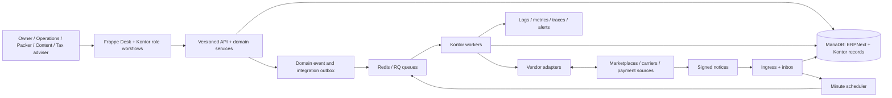
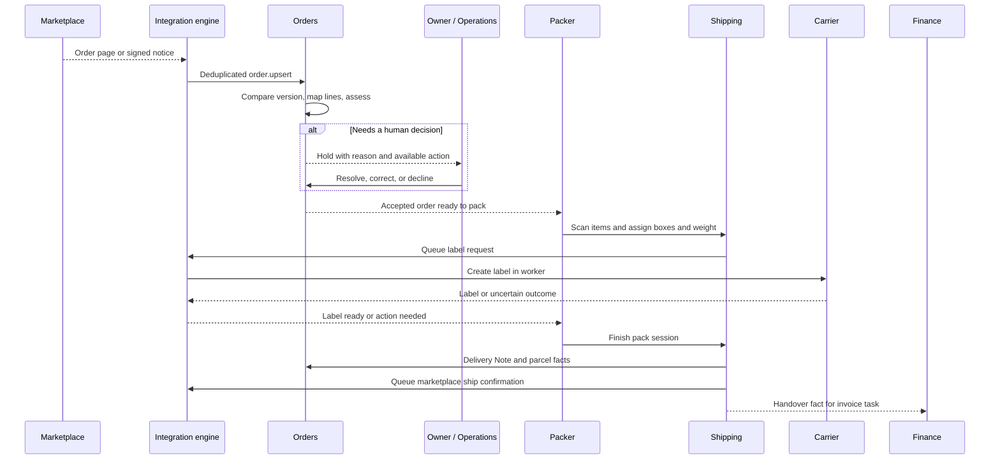

# Kontor — architecture and engineering notes

Kontor is a commerce operations system built on ERPNext and Frappe. I designed and built it for a seller whose team now handles 1,000+ orders a month in the product. Kontor is rolling out across more of the seller's stores to replace a legacy system. It connects order intake, stock, catalog, packing, parcels, returns, and accounting handoffs in role-specific workflows.

**[See the product and use the sandbox](https://kontor.hammadbhutta.dev/)** · **[Follow the interactive system flow](https://kontor.hammadbhutta.dev/#architecture)** · **[See selected work](https://portfolio.hammadbhutta.dev/)** · **[CV](https://cv.hammadbhutta.dev/)**

This repository is a public technical case study. The application source and merchant deployment remain private while a distribution and license review is pending. The public demo uses fictional records and Shopify and DHL test environments. Nothing here is a production credential, customer export, or runnable copy of the application.

## The engineering problem

An order is more than a row imported from a marketplace. Its items must map to a catalog, stock and delivery rules must be checked, a person may need to resolve a hold, the packer must know what to put in a parcel, a carrier may create a label, and returns or financial documents may follow. Each step can fail independently, and external systems may be slow, rate limited, or temporarily unavailable.

Kontor's central design choice is to keep those handoffs **durable and explainable**. A request records intent in the database; workers perform external effects; the order and operations screens show the state and the next decision.

## System at a glance

ERPNext supplies accounting and stock foundations; Kontor adds modules for channel orders, catalog, shipping, returns, finance, operations, and integrations. A vendor adapter translates its API to typed internal data. It does not own persistence or retry behavior.

## How the modules divide the work

Kontor is a modular Frappe application on ERPNext v16. It runs as one application with one transactional database. ERPNext provides stock and accounting records; Kontor adds commerce workflows and the integration engine.

| Boundary | Responsibility |
| --- | --- |
| **Orders** | Intake, version comparison, SKU mapping, assessment, holds, accepted orders, and cancellation decisions. |
| **Catalog** | Product content, listings, available-to-sell quantities, and stock pushes. Physical stock remains in ERPNext. |
| **Shipping** | Pack station, physical parcels, labels, tracking, carrier choice, and delivery handover. |
| **Returns** | Sources, cases, received units, decisions, and execution after sale. |
| **Finance** | Invoice tasks, settlement matching, and unresolved accounting handoffs. |
| **Integration engine** | Accounts, inbox/outbox, cursors, claims, rate limits, retries, dead letters, and recovery. |
| **Vendor adapters** | Translate vendor APIs to typed internal data; they do not write Frappe records or run their own retry loops. |
| **Operations** | Per-account health, order traces, alerts, and controlled replay. |

The browser does not call a marketplace or carrier directly. Human actions pass through backend permissions and domain services. External writes become Integration Events and run in workers after the local transaction commits. Domain Events record business facts for other Kontor modules. Keeping these modules in one database lets an order change and its Domain Event commit together; the cost is enforcing module ownership in code reviews and imports.

## Follow one order through the system

**Receive and assess.** A poll fetches orders after a saved cursor. Each external version enters the inbox under its integration account. The handler identifies a Channel Order by account and external order ID, ignores older versions, maps vendor items to internal SKUs, and checks address, quantities, stock, ship-by time, and tax treatment. A failed precondition creates a named hold with a reason and an owner action. The order does not silently enter the packer's ready list.

**Preserve history.** Before packing, an order change can rebuild the Sales Order. After delivery handover, delivered lines and totals remain historical facts. A later refund is recorded as a new fact instead of rewriting the original delivery. A material monetary change after acceptance is held for an owner decision.

**Pack physical boxes.** One pack session can produce multiple Parcels, each with its own contents, label, and tracking. Wrong scans, extra units, and unknown codes block progress. The packer's request queues a label operation; it does not wait inside a database transaction for the carrier. Once required labels are ready, booking creates an ERPNext Delivery Note for packed quantities. Duplicate booking work finds the already booked parcels. Marketplace shipping confirmation is another outbound event, so a marketplace outage does not undo the local delivery.

**Continue after sale.** A return can start from a marketplace request, withdrawal, returned parcel, or claim. Durable source keys attach related notices to one open case. Allocation of returnable units serializes on the order so two cases cannot claim the same units. Finance receives handover facts through Domain Event deliveries and creates invoice tasks idempotently.

## How the integration engine handles failure

Redis/RQ wakes workers; **MariaDB holds the durable record of work**. Integration Event rows hold inbound or outbound work, encrypted payload, account identity, stable key, status, attempts, and correlation ID. Domain Event and Delivery rows hold business facts and each subscriber's progress. A one-minute tick finds due or stuck rows and re-enqueues them if a job was lost.

### Inbound: cursor and inbox in one transaction

A poll stores a page's items and advances its cursor in the same transaction. If it dies before commit, it fetches the page again. A unique key based on account, topic, external ID, and version makes the repeat safe even if two workers race. An unreadable item is set aside while valid items and the cursor commit; an operator can retry or dismiss it with a reason. A signed webhook normally advances the next poll rather than becoming the only record of a marketplace change. One poll run handles up to 20 pages before a later run continues.

### Outbound: intent before effect

A domain action queues an outbound event in its current transaction. A stable key prevents the same intent from being queued twice. For last-write-wins topics such as stock push, a newer unsent value can supersede an older one. The worker commits a claim token before calling a vendor and may settle the result only while it still owns that token. A stuck-worker sweep compares tokens before reassigning work, so an old slow worker cannot overwrite a newer claim.

| Outcome | System response |
| --- | --- |
| Retryable error or rate limit | Delay the next attempt according to topic policy; reduce the operation rate when appropriate. |
| Authentication failure | Pause the account, alert operations, and preserve waiting events without burning attempts. |
| Permanent failure or exhausted budget | Move to a dead letter for correction and controlled replay. |
| Newer unsent state | Supersede the old event without reporting a vendor failure. |
| Unknown result of a non-idempotent call | Enter `in_doubt`; verify before any permitted resend. |

The hardest case is a timeout after asking a carrier to create a label or a payment provider to refund. The call may have succeeded. Kontor records the call key and send time before the call. On uncertainty, it asks the vendor for the outcome if that topic supports verification. A confirmed operation is settled; a confirmed absence may be resent only when the topic permits it, at most once automatically. An ambiguous result goes to a person. This is a durable local intent and an explicit recovery path, **not an exactly-once claim across a network**.

A domain service writes its business record, Domain Event, and one Delivery per subscriber in one transaction. Deliveries are at least once, so handlers must tolerate repetition. A failing handler's writes roll back before its retry is recorded.

## Identity, permissions, and operational visibility

An Integration Account binds a company, adapter, environment, and merchant identity. Events carry the identity captured when queued or received; an account edit cannot silently send old work as another merchant. Accounts can be off, observe, or live. Observe mode records a simulated write outcome. Adapters receive account context, a secret store, HTTP client, token cache, clock, and logger; they have no direct database access. Secrets are decrypted on demand, and token refresh is serialized across workers.

Owner, operations, packer, content, and tax-adviser workflows have backend role and record permission checks. A packer sees the facts needed to pack; cost and margin data are restricted to owner and finance roles. Integration payloads are encrypted with the Frappe site key and purged on adapter-specific schedules. Logs use identifiers and bounded error details instead of raw buyer payloads. Signed notices are verified at ingress, and all vendor writes leave through workers.

Health views combine poll lag, account pause, dead events, set-aside records, in-doubt calls, and expiring credentials. Correlation IDs join calls, events, alerts, and logs into an order trace. Prometheus metrics and Grafana dashboards cover integration and infrastructure behavior. Recovery actions are role restricted and recorded.

## Decisions and limits

| Decision | Benefit | Cost or limit |
| --- | --- | --- |
| ERPNext/Frappe foundation | Reuse stock and accounting records. | Their conventions shape modules, permissions, and deployment. |
| One app with domain modules | Commit business change and event together. | Ownership boundaries must be enforced in code. |
| Polling with webhooks as accelerators | Recover when notices are dropped or disabled. | Intake can lag; rate limits and cursors need care. |
| Database-backed inbox/outbox | Work survives Redis loss or worker restart. | More rows, retention work, and operational states. |
| External writes after commit | Slow vendors do not hold a user's transaction open. | UI must show pending, failed, and uncertain states. |
| Parcel per physical box | Contents, label, tracking, and returns attach to the right unit. | Order-level views must summarize multiple boxes. |
| Visible holds and manual recovery | A person knows why work stopped and what to do. | Some cases cannot be fully automated. |

The public demo proves the role screens and connected test flows visible there. It does not imply that every vendor offers the same capabilities or that test connections are live merchant integrations.

## Deeper documentation

| Document | What it explains |
| --- | --- |
| [System boundaries](docs/system-boundaries.md) | Modules, ownership, deployment, and why adapters stay separate from domain services. |
| [Event processing](docs/event-processing.md) | Inbox, outbox, idempotency keys, worker claims, retries, concurrency, and uncertain external effects. |
| [Order to parcel](docs/order-to-parcel.md) | A concrete order path from marketplace intake through human decisions, packing, carrier work, and later returns. |
| [Security and operations](docs/security-and-operations.md) | Roles, company and data boundaries, credentials, observability, recovery, and verification strategy. |
| [Engineering decisions](docs/engineering-decisions.md) | Tradeoffs and limits, including where this design deliberately favors reliability over immediacy. |

## What to inspect in the live sandbox

1. Open the [Kontor product page](https://kontor.hammadbhutta.dev/) and choose the **Owner** account. Inspect Channel Orders and an order on hold; the reason and next action are placed with the order.
2. Switch to **Packer**. The pack station presents the parcel's items and actions without exposing owner-level settings.
3. Return to **Owner** and inspect the Shipping Work Queue and parcel state.
4. Use the other role accounts to see how catalog and finance work are separated.

The public environment is a demonstration, not evidence that every vendor adapter is connected to a live merchant. Its Shopify and DHL connections use test environments; its buyer and company records are fictional.

## Implementation map

These paths identify where the mechanisms live in the private application source. They are here to make this case study reviewable in an interview, not to imply that the source is public.

| Mechanism | Private source location |
| --- | --- |
| Adapter contract and typed DTOs | `kontor/connectors/base/` |
| Polling and cursor persistence | `kontor/engine/runtime/polling.py` |
| Integration inbox/outbox | `kontor/engine/runtime/store.py` |
| Claim, call, settle, and recovery | `kontor/engine/runtime/runner.py` |
| Domain-event outbox and delivery | `kontor/engine/runtime/dispatch.py` |
| Minute tick and stuck work | `kontor/engine/runtime/scheduler.py` |
| Order, shipping, returns, and catalog | `kontor/kontor_orders/`, `kontor/kontor_shipping/`, `kontor/kontor_returns/`, `kontor/kontor_catalog/` |
| Integration and role journey checks | `kontor/engine/tests/integration/`, `kontor/scenarios/integration/` |

## Scope and authorship

I designed and implemented Kontor end to end. It is handling 1,000+ orders a month for one seller, with rollout across more stores underway to replace a legacy system. The public sandbox is separate from that merchant's records. This repository describes the architecture as implemented in October 2026; operational configuration and vendor capabilities may change.

© 2026 Hammad Bhutta. Documentation in this repository is available under [CC BY 4.0](LICENSE). The license does not cover the private Kontor application or third-party products.
