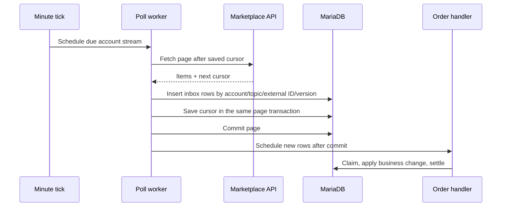
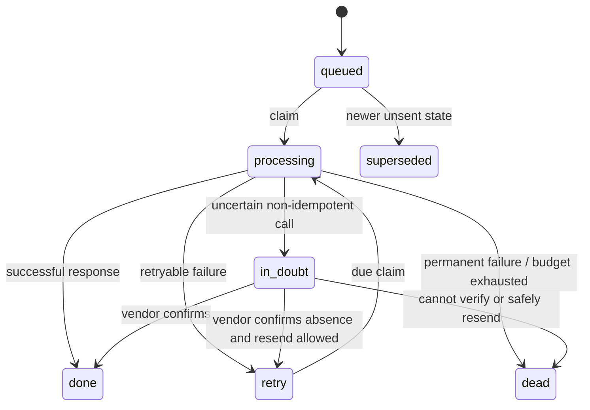

# Event processing, idempotency, and failure recovery

Kontor treats a queue as a way to wake a worker, not as the only copy of work. Integration Event rows and Domain Event rows live in MariaDB. Redis/RQ jobs point at those rows. A scheduler can find due rows again after a lost enqueue, restart, or worker failure.

## Two event types

| Record | Purpose | Example |
| --- | --- | --- |
| **Integration Event** | A vendor item entering Kontor or an outbound vendor call waiting to run. | `order.upsert`, `stock.push`, label creation, refund. |
| **Domain Event + Delivery** | A business fact committed with its owning record, plus one durable delivery per subscriber. | An order change triggering shipping, finance, or an operations view. |

The integration event stores its encrypted payload, account identity, idempotency key, status, attempts, timing, and correlation ID. Its raw payload has an adapter-specific retention period. The domain event records who or what changed, subject, version, correlation, and causation; delivery rows track each handler separately.

## Inbound: polling first

The cursor advances **with** the page's stored items. If the process dies before commit, the page is fetched again. If a duplicate arrives, its key returns the existing event. The database uniqueness rule closes the race where two workers first see no row. Up to 20 pages are handled in one polling run; a later run continues from the saved cursor.

A webhook is a signed hint to poll sooner, or a durable notice for a topic that has a direct handler. Polling remains the recovery path when vendors drop or stop sending notices. A malformed item does not have to block the whole page: an unreadable item is recorded as set aside while valid items and the cursor commit. A person can retry or dismiss that item with a reason.

## Outbound: write intent, then call

An order or catalog action queues an outbound Integration Event in its current transaction. A stable key derived from account, topic, subject, and intent prevents that same intent from being queued twice. Some topics, such as stock push, also have a **coalescing key**: a newer queued value supersedes an older queued value that has not been sent.

The claim is committed before an external call. Each claim gets a token; the worker settles the event only while it still owns that token. A stuck-worker sweep compares tokens, not wall-clock timestamps, before reassigning work. This prevents a slow, old worker from overwriting the outcome of a new claim.

The runner distinguishes failures:

- **Retryable**: wait according to the topic's retry schedule. A rate-limit response also reduces the operation's rate temporarily.
- **Authentication**: pause the account and alert an operator. Waiting events do not consume attempts while the account is paused.
- **Permanent**: move to a dead letter. A permitted operator can replay after fixing the cause.
- **Superseded**: finish an outdated last-write-wins request without treating it as a failure.
- **Unknown outcome**: follow the `in_doubt` path below.

## The hard case: a call may have happened

Creating a carrier label or sending a refund is not always safe to repeat. A timeout after sending a request says nothing about whether the vendor completed it. Before making such a call, Kontor commits its call key and send time. On an uncertain outcome it marks the event **in doubt** and does not blindly retry.

When the topic supports verification, a later worker asks the vendor for that key. A confirmed operation is settled with the vendor result. A confirmed absence may be resent only if that topic permits it, and then at most once automatically. If verification is impossible or ambiguous, the event becomes a dead letter with an explanation for a person. The module that queued the call receives `in_doubt` as a distinct outcome; it is not treated as a normal refusal.

This reduces duplicate labels and refunds, but it does not claim exactly-once delivery across a network. The guarantee is narrower: a durable local intent, deduplicated local processing, explicit handling of uncertainty, and human recovery when the vendor cannot answer.

## Domain events and concurrency

A domain service writes its business record, the Domain Event, and one Delivery row per registered handler in **one database transaction**. Delivery is at least once. Handlers must therefore tolerate a repeat. Deliveries for one event and queue run in registration order; a subject's earlier waiting delivery is considered before a newer one. A failing handler's writes roll back to a savepoint before its retry is recorded.

Inbound handlers that lose a transaction to another worker retry in a fresh transaction a bounded number of times before normal backoff. Manual replay locks the event row so two operators cannot both move a dead event back to the queue. A one-minute tick re-enqueues due integration events and deliveries, recovers stuck claims, refreshes dead-letter alerts, and schedules account polls. Due integration work is selected in turns across accounts so one account's backlog does not monopolize a batch.

## Operational questions this design answers

| Question | Where to look |
| --- | --- |
| Did the marketplace send the same order twice? | Integration key: account + topic + external ID + version. |
| Was work lost when Redis was unavailable? | Durable event/delivery row remains due; the tick schedules it again. |
| Did the worker die during a carrier call? | Claim and send markers distinguish a safe retry from an in-doubt call. |
| Why is one account not moving? | Account mode, pause reason, stream lag, queued/dead/in-doubt counts, and alerts. |
| What happened to this order? | Correlation ID joins calls, requests, events, alerts, and logs in an order trace. |

The private implementation anchors are `engine/runtime/{store,polling,runner,dispatch,scheduler,jobs}.py`; the relevant integration checks include `test_claims.py`, `test_in_doubt.py`, `test_queue.py`, and `test_poll_failure.py`.
