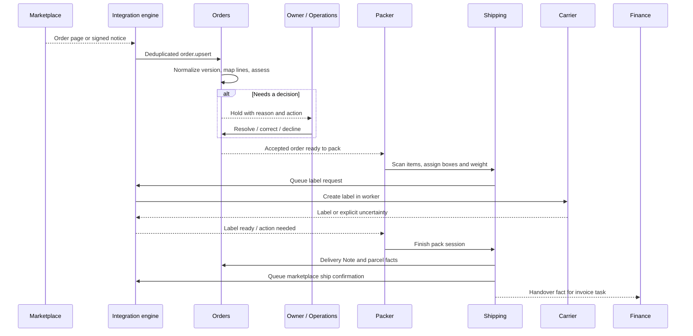

# A marketplace order, from intake to parcel

This is a representative workflow, not a promise that every vendor exposes the same fields or capabilities. The public sandbox has synthetic records so an interviewer can follow it without touching a real buyer.

## 1. Receive and normalize

A stream poll fetches marketplace orders after a saved cursor. The engine stores each version as an inbound `order.upsert` event. The order handler maps the vendor DTO to one Channel Order identified by **integration account + external order ID**. An older version is ignored. A newer version is compared with what is already accepted or handed over.

The distinction matters: before packing, a changed line or total can rebuild the Sales Order. After handover, the original delivered lines and total remain historical facts; a later marketplace refund is recorded as a refund fact, rather than silently rewriting the delivered order. A change to core monetary identity after acceptance is held for an owner decision.

## 2. Assess before making work for a packer

Assessment maps marketplace SKUs to internal items and checks the facts needed for fulfillment, such as address, line quantities, stock, ship-by time, and tax treatment. A failed precondition becomes a **hold code with a reason**. The order page and work queue show the reason and the action a person can take. This keeps an unresolved order out of the packer's ready list.

The owner/operations path is a product choice as much as a technical one: the system should explain why it stopped and who can unblock it. A visitor can see this on an on-hold Channel Order in the [live sandbox](https://kontor.hammadbhutta.dev/#explore).

## 3. Pack a physical parcel

A pack session represents one order packed in one go. It can contain more than one Parcel; a parcel names the specific order lines and units in that box. The station guides the packer through scan, box, weight, carrier, label, and finish. A wrong item, extra unit, or unknown code blocks the box. The packer must correct the contents or explicitly put the order back with a reason.

The web request does **not** call the carrier. The label request enters the integration outbox. If the label is still pending when the packer finishes, the session records that intent and booking proceeds when all required labels return. If a carrier response is uncertain, the label is treated as in doubt; another label is not requested blindly.

Once the finished session is labelled, booking creates the ERPNext Delivery Note for the packed quantities and associates it with the parcels. The operation is idempotent: a duplicate job finds already booked parcels. Shipping confirmation back to a marketplace is another outbound integration event, so a marketplace outage does not undo the local delivery record.

## 4. Keep the later facts connected

Carrier tracking changes update parcel state. A return can begin from a marketplace request, a logged withdrawal, a parcel returned to sender, an unannounced parcel, or a claim. Return sources have durable keys; when a new source refers to the same open return, it attaches to that case instead of opening a duplicate. Allocation of returnable units serializes on the order lock so two cases cannot claim the same units at once.

Finance reacts to the handover and other business facts through domain-event deliveries. Invoice tasks are keyed to the delivery evidence, checked for applicability and missing facts, and issued idempotently. Problems are assigned to the role that can resolve them rather than buried in a generic worker error.

## Questions to ask in an interview

- What happens if the marketplace sends version 3 before version 2?
- Which facts may change before packing, and which become immutable after handover?
- How does the packer recover from a wrong scan without making a carrier label?
- If a worker times out after asking for a label, what evidence is needed before trying again?
- How can a return from two sources be recognized as one case?

Those cases shaped the workflow screens, event keys, locks, and recovery states described in [event processing](event-processing.md).
