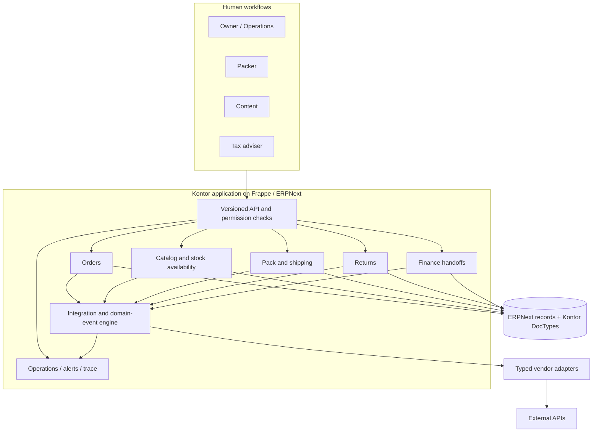

# System boundaries

## Architectural shape

Kontor is a Frappe application on ERPNext v16. It is deployed as one application and one site, with several domain modules inside it. This keeps database transactions available across business records while preserving ownership in code. The modules share the integration engine and a small set of pure helpers; vendor-specific behavior stays behind adapter contracts.

The browser does not call a marketplace or carrier directly. Human actions enter through permission-checked API endpoints and domain services. External effects are queued as integration events and performed by workers after the database transaction commits. A domain event records a business fact for other modules to consume; it is not a vendor API call.

## Ownership

| Area | Owns | Deliberate boundary |
| --- | --- | --- |
| Orders | Channel order intake, assessment, holds, customer/order mapping, status and cancellation decisions | Does not implement vendor HTTP details or carrier labels. |
| Catalog | Product content, listings, SKU mapping, available-to-sell quantities, stock pushes | Keeps physical stock in ERPNext; publishes a derived availability view. |
| Shipping | Pack station, parcels, labels, manifests, tracking, carrier choice | A parcel is the carrier unit; an order may need more than one parcel. |
| Returns | Return cases, received items, decisions, and execution | Handles after-sale actions explicitly instead of rewriting the original order. |
| Finance | Invoice tasks, settlements, matching, period-close checks | Builds on ERPNext accounting records and exposes unresolved handoffs. |
| Integration engine | Inbound/outbound events, scheduling, claims, rate limits, retries, alerts | Knows how to execute work, not what a specific vendor's fields mean. |
| Adapters | Translation between vendor APIs and typed Kontor DTOs | No Frappe database access, independent retry loop, or global state. |
| Operations | Health, traces, metrics, manual replay and recovery | Recovery actions are role restricted and recorded. |

The implementation uses one app with `kontor_<module>` folders because Frappe module names are global. Interfaces between modules are domain services, typed payloads, and durable domain events. The engine's adapter registry checks declared capabilities against implemented methods.

## The persistence and execution boundary

**MariaDB** stores ERPNext records, Kontor DocTypes, integration events, domain events, deliveries, and sync cursors. The event rows are the durable record of work. **Redis/RQ** transports jobs to workers and backs cache or rate-limit state; it is not the sole record of business intent. A one-minute tick scans for due work and re-enqueues it when a post-commit enqueue or a worker is lost.

Jobs are separated into order, sync, report, agent, and tick queues. The production recipe has dedicated services for HTTP, WebSocket, scheduler, and workers. The image is built from pinned app revisions and a source commit; site data and credentials are supplied at runtime, not baked into the image.

## An integration account is a boundary

An Integration Account identifies a company, adapter, environment, and merchant identity. It can be **off**, **observe**, or **live**. Observe mode executes checks and records a simulated outcome without making a vendor write. Events carry the account identity captured when queued or received. If that identity changes before execution, the runner does not send the old event under a new merchant identity; it surfaces the mismatch for review.

Each adapter receives a context for its account, typed configuration, a secret store, token cache, HTTP client, clock, and logger. Secrets are decrypted on demand. Token refresh is serialized across workers, and a token identifying the wrong merchant is rejected.

## Why a modular monolith

A single transactional database lets an order change and its domain event commit together. Separate services would require a distributed transaction or additional reconciliation just to maintain that invariant. The cost is that module boundaries have to be enforced in code reviews and import contracts. It is a suitable tradeoff for this product's current scale; the queue and adapter contracts give clear seams if an integration later needs its own process.
